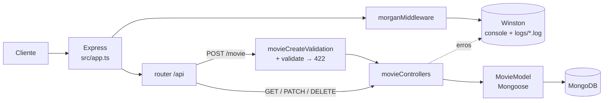

# NexusAPI

API REST de filmes em Express + TypeScript + MongoDB (Mongoose), com validação via express-validator e logs estruturados com Winston + Morgan.

## Funcionalidades

- CRUD de filmes em `/api/movie` (título, gênero, descrição, nota, diretor, elenco, pôster).
- Validação na criação: título com 5+ caracteres, nota numérica de 0 a 10, descrição e diretor obrigatórios, pôster precisa ser URL. Erros voltam com status `422` e um item por campo.
- Logger Winston com 5 níveis (`error`, `warn`, `info`, `http`, `debug`), cores no console e um arquivo por nível em `logs/`.
- Morgan envia cada requisição HTTP para o nível `http` do Winston (só em `env: "development"`).
- Configuração com o pacote `config` (`config/default.ts`) e credenciais do banco no `.env`.

## Como funciona



Documento `Movie` (`src/models/Movie.ts`, com `timestamps`): `title`, `kind`, `description`, `rating` (Number), `director`, `stars` (Array), `poster`, `createdAt`, `updatedAt`.

## Stack

Node.js, TypeScript, Express 5, Mongoose 8, express-validator 6, Winston, Morgan, config, dotenv, ts-node-dev.

## Como rodar

Pré-requisitos: Node.js 20+ e um MongoDB.

```bash
npm install
cp .env.example .env      # DB_USER e DB_PASSWORD do cluster MongoDB Atlas
npm run dev               # http://localhost:3000/api/test
```

| Variável | Uso |
| --- | --- |
| `DB_USER` | usuário do MongoDB Atlas, interpolado em `config/default.ts` |
| `DB_PASSWORD` | senha do MongoDB Atlas |

A porta (`3000`), o ambiente (`development`) e a URI do cluster ficam em `config/default.ts`. Para usar um MongoDB local sem mexer no código, sobrescreva a configuração com a variável `NODE_CONFIG` do pacote `config`:

```bash
docker run -d --name nexus-mongo -p 27017:27017 mongo:7
NODE_CONFIG='{"dbUri":"mongodb://127.0.0.1:27017/nexusdb"}' npm run dev
```

## API

Base: `http://localhost:3000/api`

| Método | Rota | Descrição | Respostas |
| --- | --- | --- | --- |
| GET | `/test` | retorna `API Working!` | 200 |
| POST | `/movie` | cria filme (validado) | 201, 422, 500 |
| GET | `/movie` | lista filmes | 200, 500 |
| GET | `/movie/:id` | busca por ObjectId | 200, 404, 500 |
| PATCH | `/movie/:id` | atualiza campos (sem validação) | 200, 404, 500 |
| DELETE | `/movie/:id` | remove | 200, 404, 500 |

Saída real com dados fictícios:

```text
$ POST /api/movie  {"title":"Filme Exemplo","rating":8.5,"description":"Um filme fictício para testar a API.","director":"Diretora Exemplo","stars":["Ator A","Atriz B"],"poster":"https://example.com/poster.jpg","kind":"Drama"}
{"title":"Filme Exemplo","kind":"Drama",…,"_id":"6b06166fbce9c446d65cb8a9","createdAt":"2026-11-24T22:57:51.287Z","updatedAt":"2026-11-24T22:57:51.287Z","__v":0}
$ POST /api/movie  {"title":"Abc","rating":11,"poster":"nao-e-url"}
{"errors":[{"title":"Titulo precisa ter no minimo 5 caracteres"},{"rating":"A nota precisa ser entre 0 a 10"},{"description":"A descrição é obrigatoria"},{"director":"O diretor é obrigatorio"},{"poster":"O poster precisa ser uma URL"}]}
$ PATCH /api/movie/6b06166fbce9c446d65cb8a9  {"rating":9}
{"rating":9}
$ GET /api/movie/000000000000000000000000
{"error":"O filme não existe"}          (404)
$ GET /api/movie/abc
{"message":"O filme não existe"}        (500)
$ DELETE /api/movie/6b06166fbce9c446d65cb8a9
{"msg":"O filme foi removido com sucesso"}
```

Documentação da API:

- OpenAPI 3 (escrito à mão a partir das rotas): [`docs/openapi.yaml`](docs/openapi.yaml). Para visualizar, cole em [editor.swagger.io](https://editor.swagger.io) ou rode `npx @redocly/cli@1.34.3 preview-docs docs/openapi.yaml`.
- Postman: importe [`docs/postman/NexusAPI.postman_collection.json`](docs/postman/NexusAPI.postman_collection.json). `baseUrl` vem como `http://localhost:3000/api`, e "Criar filme" salva o `_id` em `movieId` para as outras requisições.

## Estrutura

```
config/
├── default.ts        # porta, env e URI do MongoDB
├── db.ts             # mongoose.connect, encerra o processo se falhar
└── logger.ts         # Winston: níveis, cores e arquivos em logs/
src/
├── app.ts            # Express, morgan, rotas em /api, conecta no banco ao subir
├── router.ts
├── controllers/movieControllers.ts
├── middleware/       # movieValidation, handleValidation (422), morganMiddleware
└── models/Movie.ts
logs/                 # arquivos de log (versionados no repositório)
docs/                 # openapi.yaml e coleção Postman
```

## Testes

Não há testes automatizados (`npm test` só imprime a mensagem padrão do npm). `npx tsc --noEmit` compila sem erros.

## Limitações conhecidas

Encontradas rodando a API localmente:

- Em `GET`, `PATCH` e `DELETE /movie/:id`, o `404` não tem `return`: a função continua, tenta responder de novo e loga `Cannot set headers after they are sent to the client`. O cliente recebe o 404, mas o log de erro fica poluído.
- Id fora do formato ObjectId cai no `catch` e retorna `500` com a mensagem "O filme não existe".
- `PATCH` não valida o body e responde com o próprio body enviado, não com o filme atualizado.
- A pasta `logs/` está versionada e não está no `.gitignore`; rodar a API altera arquivos rastreados.
- A porta é fixa em `config/default.ts` (não lê `PORT`).
